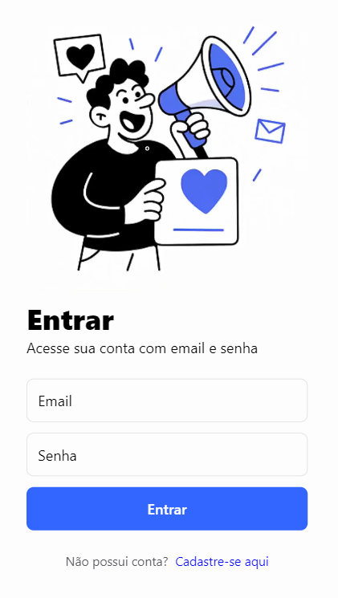

# 📱 Estudos React Native

Repositório dedicado aos projetos desenvolvidos durante meus estudos de **React Native**, com o objetivo de praticar conceitos, explorar funcionalidades e consolidar conhecimentos no desenvolvimento mobile.

Este repositório reúne exclusivamente projetos de estudo. Projetos desenvolvidos para portfólio terão seus próprios repositórios, com documentação e apresentação dedicadas.

---

## 📂 Projetos

### 01. Tela de Login e Cadastro

Projeto desenvolvido acompanhando o vídeo [React Native em 2026: Guia Prático e Completo para Começar do Zero](https://www.youtube.com/watch?v=7uGjAMhI8G4&t=301s), dos canais **Rodrigo Gonçalves e Rocketseat**.

**Prévia do projeto**

| Tela de Login | Tela de Cadastro |
|:---:|:---:|
|  |  |

**Conteúdos aprendidos**

### 📚 Conteúdos aprendidos

**1. Introdução ao React Native**
- Funcionamento do React Native e sua proposta multiplataforma.
- Diferenças entre React Native e desenvolvimento web: ausência de DOM, HTML e CSS tradicional.
- Uso de componentes nativos e agnósticos para construção das interfaces.
- Reutilização de conceitos do React, como props, state, hooks e eventos.

**2. Expo**
- O que é o Expo e como ele facilita o desenvolvimento com React Native.
- Criação e inicialização de projetos utilizando Expo CLI.
- Utilização do Expo Go para executar e testar aplicações em dispositivos físicos.
- Conhecimento sobre Development Builds.

**3. Estrutura de projetos**
- Organização de telas, componentes, constantes, hooks e assets.
- Função dos principais arquivos de configuração, como `app.json` e `package.json`.
- Organização do código dentro da pasta `src`.
- Configuração de caminhos com alias `@`.

**4. Componentes e estilização**
- Utilização dos componentes fundamentais: `View`, `Text`, `Image`, `TextInput`, `TouchableOpacity`, `ScrollView` e `FlatList`.
- Estilização com `StyleSheet.create()` e propriedades inline.
- Diferenças do Flexbox no React Native, incluindo `flexDirection: "column"` como padrão.
- Uso de propriedades em camelCase e valores numéricos sem unidades de medida.
- Diferenças na herança e aplicação de estilos em relação ao CSS tradicional.

**5. Propriedades e reutilização**
- Configuração de campos com `secureTextEntry`, `editable` e `keyboardType`.
- Controle da opacidade de componentes interativos com `activeOpacity`.
- Utilização de Rest Properties (`...rest`) e Spread Syntax para repassar propriedades entre componentes.

**6. Navegação com Expo Router**
- Organização de telas por meio de arquivos e rotas.
- Utilização de `export default` nas telas.
- Navegação entre páginas com o componente `Link` e a propriedade `href`.

**7. Eventos e experiência do usuário**
- Adaptação de eventos para os componentes do React Native.
- Utilização do `KeyboardAvoidingView` para adaptar a interface à abertura do teclado.
- Configuração do comportamento do teclado por plataforma com `Platform.select`.
- Utilização de `keyboardShouldPersistTaps` no `ScrollView` para controlar a interação com os elementos enquanto o teclado está aberto.

## 🛠️ Tecnologias

- React Native
- JavaScript
- Expo

